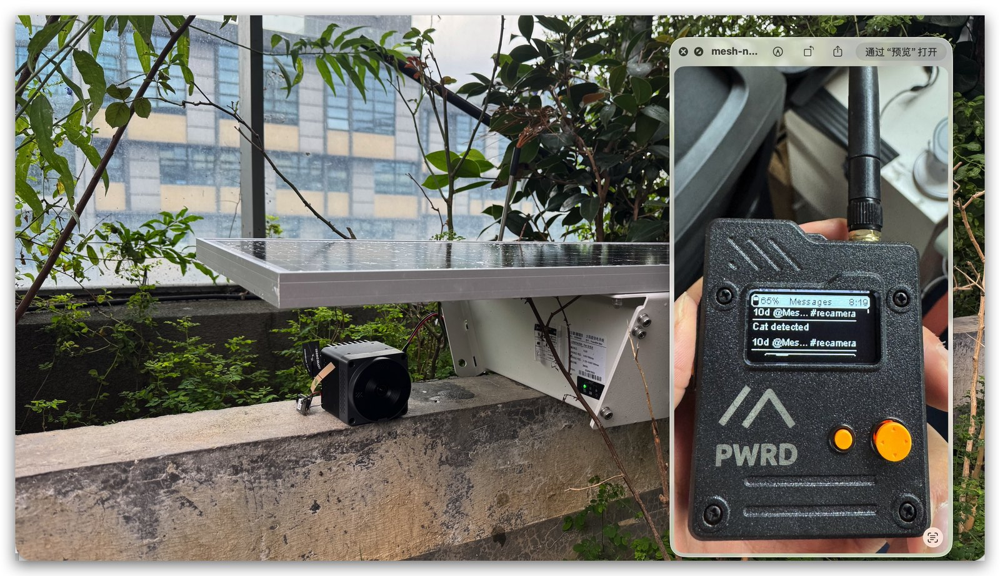

# AI in the Wild

一个将人工智能、野外传感器和边缘计算应用于野生动物研究与保护的开源计划。

[English README](README.md)

## 为什么做这个项目

野外研究会产生大量图片、视频、声音、定位和环境数据，但很多工作仍依赖人工观察、人工标注和分散工具。这个仓库的目标不是先做一个单一的动物识别模型，而是搭建一套可扩展的开源研究体系：

```text
多种野外设备采集数据 -> 统一 AI 能力处理 -> 支撑不同动物研究课题
```

第一阶段以文档、模板和数据规范为主。等具体课题和成熟代码出现后，再逐步沉淀成可复用模块。

## 示例 Demo：边缘 AI 摄像头到 Meshtastic 告警

[](projects/edge-ai-camera-meshtastic-alert/README.zh-CN.md)

reCamera Pro 识别公司附近出现的野猫，输出 GPIO 脉冲，再通过 Meshtastic 网络把 `Cat detected` 告警发送到 Wio Tracker L1 Pro 接收节点。

这里的野猫是一个安全、容易复现的代理目标，用来模拟野外老虎、狼、人兽冲突或疑似偷猎者出现时的告警链路。它是链路验证 demo，不代表已经完成生产级野生动物识别模型。

| 从这里开始 | 内容 |
|---|---|
| [阅读完整 demo 介绍](projects/edge-ai-camera-meshtastic-alert/README.zh-CN.md) | 一整篇项目说明，包含设备、接线、Meshtastic 配置、reCamera 程序逻辑、运行结果和限制 |
| [查看参考实现代码](reference-implementations/recamera-meshtastic-trigger/) | 相机侧触发脚本、运行日志、抓拍工具和 Meshtastic 节点设置说明 |
| [查看硬件和配置图片](projects/edge-ai-camera-meshtastic-alert/README.zh-CN.md#当前试点场景) | 部署、接线、供电、接收告警和配置界面截图 |

## 六个研究方向

| 方向 | 核心问题 | AI 能力 |
|---|---|---|
| [个体识别与全生命周期追踪](docs/research-themes/01-individual-identification/README.md) | “这是哪一只？”以及它一生发生了什么 | Re-ID、特征嵌入、目标跟踪、生命史档案 |
| [声学监测与应激信号](docs/research-themes/02-acoustic-monitoring/README.md) | 动物发出了什么声音，是否存在压力或异常 | 生物声学、声音事件检测、分类 |
| [种群数量统计与动态监测](docs/research-themes/03-population-monitoring/README.md) | 有多少只，数量如何增减 | 检测、计数、占域模型 |
| [群体社交行为网络](docs/research-themes/04-social-networks/README.md) | 谁经常在一起，群体关系如何组织 | 多目标跟踪、关联分析、图分析 |
| [栖息地健康与食源承载力](docs/research-themes/05-habitat-capacity/README.md) | 食物和环境是否能够支撑种群 | 传感器融合、时间序列、地理空间分析 |
| [认知衰退与衰老行为](docs/research-themes/06-cognitive-aging/README.md) | 行为是否随年龄、疾病或压力变化 | 长期行为分析、异常检测、多模态 AI |

“繁殖”可以作为跨主题标签处理：个体识别记录繁殖史，种群监测计算幼体比例，社交网络分析亲缘和配偶关系，栖息地研究环境对繁殖成功率的影响。

## 仓库结构

| 路径 | 用途 |
|---|---|
| `docs/` | 愿景、系统架构、野外部署、数据治理、研究主题、硬件和 AI 能力说明 |
| [`projects/edge-ai-camera-meshtastic-alert/`](projects/edge-ai-camera-meshtastic-alert/README.zh-CN.md) | 第一个试点 demo：边缘 AI 摄像头识别到 Meshtastic 告警 |
| [`reference-implementations/recamera-meshtastic-trigger/`](reference-implementations/recamera-meshtastic-trigger/) | 第一个试点 demo 的可复用脚本和设置说明 |
| `projects/` | 项目提案说明、项目模板和试点示例 |
| `reference-implementations/` | 经过试点验证后沉淀的轻量参考实现 |
| `schemas/` | 野外研究通用记录的 JSON Schema |
| `.github/` | Issue 模板、PR 模板和文档检查 |

## 如何参与

- 带来真实研究问题或野外部署需求。
- 使用项目模板发起研究项目。
- 补充研究主题中的传统方法、痛点、数据类型和设备经验。
- 贡献数据前，先确认授权、敏感性和物种风险。
- 等代码在真实项目里验证后，再沉淀为 reference implementation。

请先阅读 [CONTRIBUTING.md](CONTRIBUTING.md) 和 [RESPONSIBLE_RESEARCH.md](RESPONSIBLE_RESEARCH.md)。
