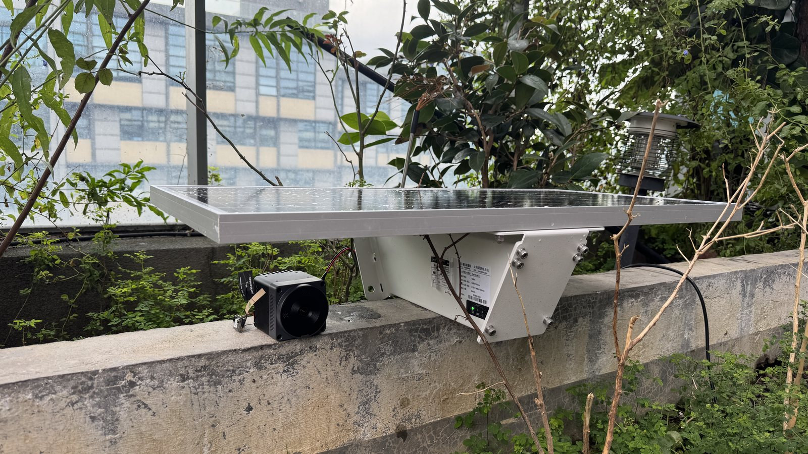
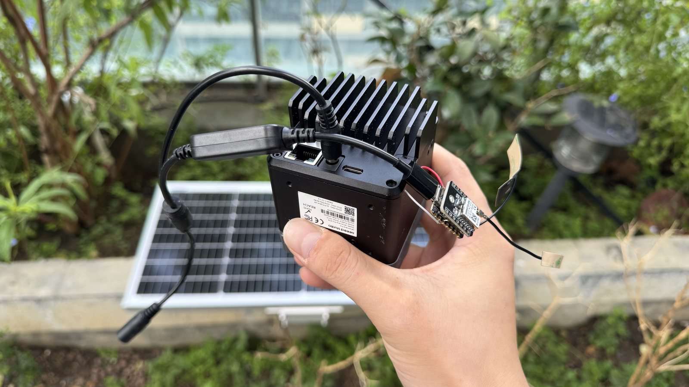

# Edge AI Camera to Meshtastic Alert Demo

[中文](README.zh-CN.md)

This project is a small, reproducible demo for the Open Datalogger For Interspecies initiative. It uses a reCamera Pro to detect stray cats around an office, then sends a Meshtastic alert to a Wio Tracker L1 Pro receiver.

The cat is a safe proxy target. In a real field deployment, the same workflow could be adapted for target wildlife or risk events such as a tiger, wolf, livestock-conflict event, or potential poacher. This demo does not claim that a production tiger or wolf detector is finished. It validates the chain:

```text
edge AI detection
-> physical GPIO trigger
-> low-power mesh alert
-> field receiver notification
```


## What This Demo Shows

Many field cameras can store photos or video, but researchers often learn what happened only after retrieving the device or downloading its data. This demo explores a faster alert pattern: the camera detects a target locally, emits a simple GPIO signal, and lets a low-power Meshtastic network carry the event to a receiver.

In the office pilot, the system sends a `Cat detected` message when the camera-side logic confirms a target event.



## Hardware

| Device | Role in This Demo | Purchase Link |
|---|---|---|
| reCamera Pro 2GB | Edge AI camera. Runs local inference, saves trigger snapshots, and outputs a GPIO pulse. | [Seeed Studio](https://www.seeedstudio.com/reCamera-Pro-2GB.html) |
| Wio SX1262 with XIAO ESP32S3 | Meshtastic transmitter node. Reads the camera GPIO signal and sends the mesh alert. | [Seeed Studio](https://www.seeedstudio.com/Wio-SX1262-with-XIAO-ESP32S3-p-5982.html) |
| Wio Tracker L1 Pro | Meshtastic receiver. Displays the alert message in the field. | [Seeed Studio](https://www.seeedstudio.com/Wio-Tracker-L1-Pro-p-6454.html) |
| Solar power supply | Outdoor power source for the pilot deployment. | Use a power system sized for the camera and radio duty cycle. |



## System Flow

```text
Stray cat appears
        |
        v
reCamera Pro detects cat from local AI inference
        |
        v
Camera trigger program validates the target class
        |
        v
GPIO188 outputs a 3.3 V pulse for 3 seconds
        |
        v
Wio SX1262 with XIAO ESP32S3 reads the GPIO state
        |
        v
Meshtastic Detection Sensor module sends "Cat detected"
        |
        v
Wio Tracker L1 Pro receives the alert
```

## Wiring

The validated camera-side trigger pin is Linux GPIO188, mapped to `CAN0_RXD_M0 / GPIO5_D4` on the reCamera Pro expansion connector. In this demo, it is used as a 3.3 V digital output.

Connect:

| reCamera Pro | Meshtastic Transmitter Node |
|---|---|
| GPIO188 / `CAN0_RXD_M0 / GPIO5_D4` | Detection Sensor monitor input |
| GND | GND |

The devices must share ground. Do not connect the earlier 12 V output pins directly to an ESP32 or Meshtastic GPIO input.


## Meshtastic Setup

Flash Meshtastic firmware to the transmitter and receiver nodes using the official [Meshtastic Web Flasher](https://flash.meshtastic.org/). Use a data-capable USB cable, select the target device, choose a stable firmware release, and flash the device from a Chrome or Edge browser.

After both devices are running Meshtastic:

1. Create or select a shared channel for the demo.
2. Use the same channel settings on the transmitter and receiver.
3. On the transmitter node, enable the Detection Sensor module.
4. Set the friendly name to `Cat` or another short label.
5. Set the monitor pin to the GPIO input connected to reCamera GPIO188.
6. Set the trigger type to `LOGIC_HIGH`.
7. Set a minimum broadcast interval to avoid repeated messages while the target remains in view.

The screenshot below shows the demo channel. The pre-shared key is intentionally redacted for public documentation.


The Detection Sensor module watches the configured GPIO input and broadcasts a message when the state changes. In this demo, the trigger is a logic-high pulse from the camera.


## reCamera Pro Setup

The camera-side program reads the local inference result stream, filters for configured target classes, and triggers GPIO188 when a target is detected.

Current demo behavior:

| Setting | Value |
|---|---|
| Target class | `cat` for the demo; `person` can be enabled during development |
| GPIO | Linux GPIO188 |
| Pulse | 3 seconds high |
| Cooldown | 60 seconds |
| Snapshot | Save one JPG when the GPIO trigger happens |
| Retention | Keep up to 1000 snapshots, then delete the oldest 100 |

The reusable camera-side scripts are stored here:

- [reCamera trigger reference implementation](../../reference-implementations/recamera-meshtastic-trigger/)

The main configuration shape is:

```ini
GPIO=188
TARGET_CLASSES=cat
MIN_SCORE=0.10
PULSE_SECONDS=3
COOLDOWN_SECONDS=60
SAVE_SNAPSHOT=1
SNAPSHOT_TARGET_KB=500
SNAPSHOT_MAX_FILES=1000
SNAPSHOT_DELETE_BATCH=100
```

## Runtime Evidence

The camera can also log runtime heartbeats and target events. This helps answer practical deployment questions:

- When was the camera online?
- When did it appear offline or reboot?
- How many target events were recorded?
- What was the rough power consumption over the observed window?


## Reproduce This Demo

1. Prepare the three devices listed in [Hardware](#hardware).
2. Flash Meshtastic firmware to the transmitter and receiver nodes.
3. Configure the Meshtastic channel and Detection Sensor module.
4. Wire reCamera Pro GPIO188 to the transmitter node monitor input, and connect GND to GND.
5. Install the reCamera trigger service from the reference implementation.
6. Configure the target class, GPIO, pulse duration, cooldown, and snapshot retention.
7. Place the camera in a test scene and confirm that a real target creates a `Cat detected` message on the receiver.
8. Download trigger snapshots and runtime logs for review.

## Limitations

- This is a workflow validation demo, not a production wildlife model.
- The office cat target is a proxy for field targets.
- Accuracy, false positives, missed detections, weatherproofing, and long-term power stability still need field validation.
- Sensitive species locations, private property, and human images should be handled under the repository's responsible research guidance.

## Next Steps

- Add selected trigger snapshots from a reviewed dataset.
- Define a compact Meshtastic alert payload format.
- Add a receiver-side setup guide for Wio Tracker L1 Pro.
- Test a real outdoor power budget over multiple days.
- Replace the proxy target with a conservation-relevant model and expert-reviewed evaluation data.
