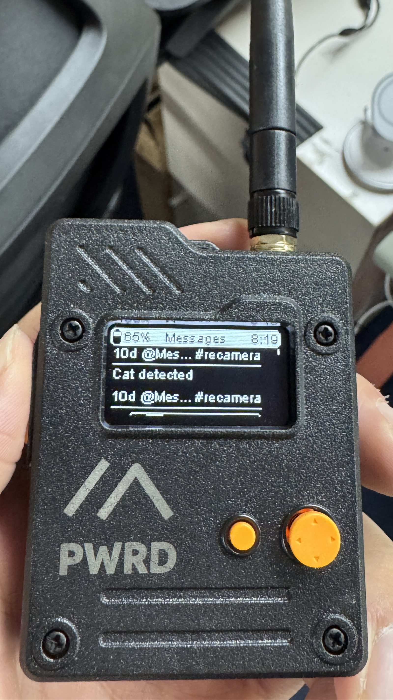
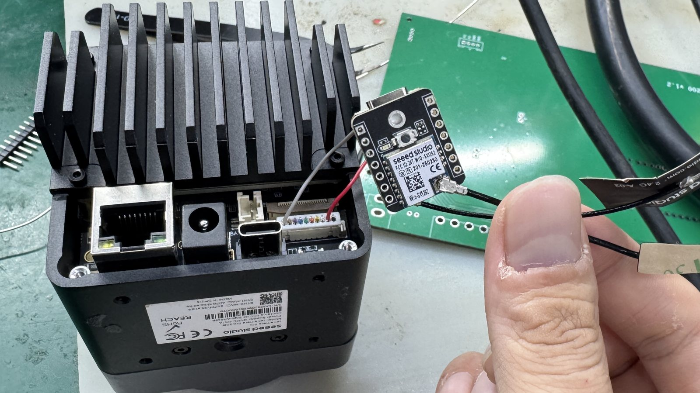
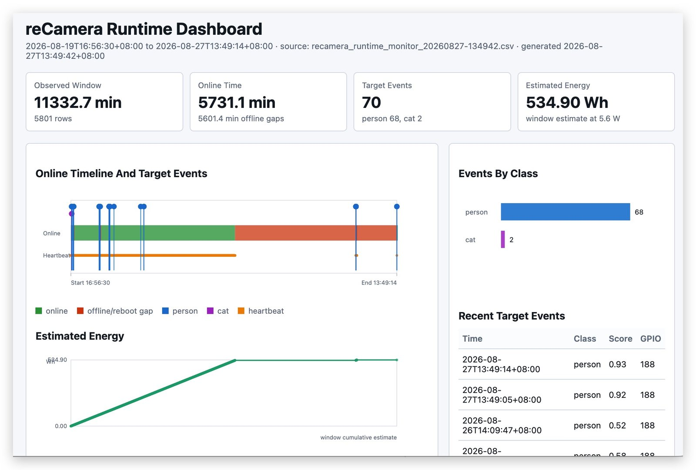
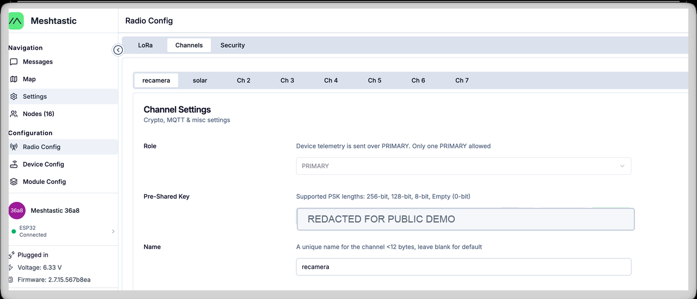
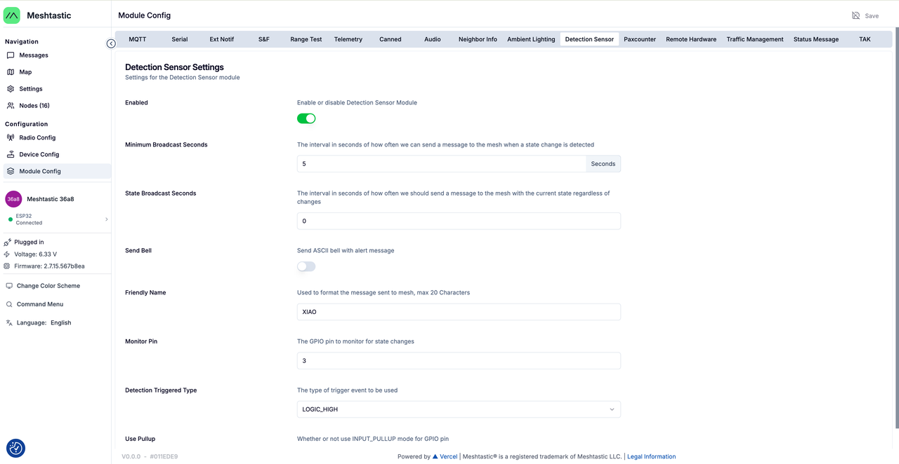

# reCamera + Meshtastic Trigger Reference

This directory contains the reusable files behind the [Edge AI Camera to Meshtastic Alert Demo](../../projects/edge-ai-camera-meshtastic-alert/).

The project page is the best place to understand the demo story and hardware chain. This directory is for people who want to reproduce or adapt the implementation.



## Demo Snapshot

The validated demo connects a reCamera Pro to a Wio SX1262 with XIAO ESP32S3 transmitter node. When the camera detects the target class, the transmitter sends a Meshtastic alert that can be received by a Wio Tracker L1 Pro.



## Directory Map

```text
recamera-pro/
  scripts/          camera-side GPIO trigger service
  runtime-logger/   optional runtime/event logger
  docs/             camera-side wiring and troubleshooting notes

meshtastic-node/
  README.md         firmware and Detection Sensor setup notes

tools/
  download_snapshots.py
  generate_runtime_dashboard.py
  export_runtime_report.py
```

## Validated Behavior

```text
reCamera Pro inference stream
-> filter for configured target classes
-> output GPIO188 high for 3 seconds
-> keep a 60-second cooldown
-> save a trigger snapshot
-> Meshtastic transmitter sends an alert
-> Wio Tracker L1 Pro receives the message
```



## Camera Pin

| Signal | Value |
|---|---|
| Linux GPIO | `188` |
| Pin function | `CAN0_RXD_M0 / GPIO5_D4` |
| Logic high | 3.3 V |
| Pulse | 3 seconds |
| Cooldown | 60 seconds |

When this pin is used as GPIO, do not use it as a CAN signal at the same time.

## Meshtastic Configuration

The transmitter node uses Meshtastic's Detection Sensor module. The channel key must be shared between nodes, but it should be redacted in public screenshots.



The monitor pin is the transmitter-side GPIO connected to reCamera GPIO188, and the trigger type is `LOGIC_HIGH`.



## Quick Start

1. Flash Meshtastic firmware to the transmitter and receiver nodes.
2. Configure the transmitter Detection Sensor module to monitor the pin wired to reCamera GPIO188.
3. Copy `recamera-pro/scripts/` to the reCamera Pro.
4. Edit `recamera_trigger.conf`.
5. Run `install.sh` on the reCamera Pro.
6. Confirm that the receiver displays `Cat detected` when the camera sees the target.

See:

- [reCamera Pro setup](recamera-pro/README.md)
- [Meshtastic node setup](meshtastic-node/README.md)

## Security Notes

- Do not commit SSH passwords, API tokens, Meshtastic channel keys, or private GPS locations.
- Redact Meshtastic pre-shared keys from screenshots before publishing.
- Do not publish sensitive wildlife locations or unreviewed human images.
